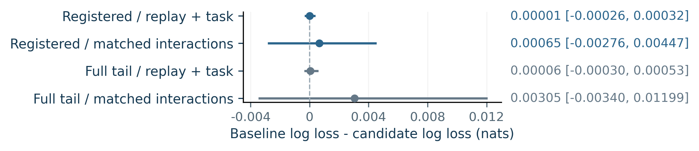

# From State Forecasts to Agent Failure Prediction

**An independent empirical investigation by Zhijing Wu, Sichuan University.**

Do task-relevant summaries of explicit state forecasts improve prediction of later agent failure beyond replay, task feasibility, and likelihood diagnostics?

**Finding: no resolved incremental gain in this cohort.** The intervals cross zero; this is an inconclusive comparison, not equivalence, disproof, a new algorithm, or an established predictive improvement. This independent project was not supervised by Professor Manling Li or Northwestern University.

## Why this question?

A detectable forecast error need not change whether an agent can finish a task. The study asks whether explicit forecast evidence carries additional information about goal failure after ordinary replay and hard task feasibility are known. RAGEN-2 already studies reasoning collapse; that phenomenon is not claimed as new here.

## Setting and evaluation

- Frozen public SPA Sokoban release; native one-box 6 x 6 boards; ten action attempts and five model turns.
- **224 saved episodes**, with family-grouped development/calibration/final splits of 64/32/128 boards. D4 wall-plus-target families are disjoint across splits.
- Landmark: after the first proposed action batch and native observation. The final at-risk set has **124 episodes: four successes and 120 failures in 102 families**.
- One shared recorded evidence packet per episode: first reply, extra initial sample, native replay, public task-distance queries, and likelihood scores. Nine views compare summaries at equal recorded spend; they are not nine independent experiments.
- Standardization and L2 logistic regression (C=1) fit development labels only. No final-set tuning. Intervals use 2,000 paired family bootstrap draws, conditional on that fit.

## Nine fixed feature views

| View | Nominal columns | Role |
|---|---:|---|
| Development prior | 0 | Smoothed development failure rate |
| State + format | 11 | Current-state accuracy and missingness |
| Ordinary replay | 12 | Explicit forecast agreement with native execution |
| Likelihood proxy | 9 | Own NLL and finite cross-input dependence |
| State + replay + likelihood | 18 | Combined generic diagnostics |
| Two-sample disagreement | 23 | Extra initial-sample disagreement |
| Replay + task / deadlock | 25 | Public distances, progress and feasibility |
| Task-relevance candidate | 34 | Nine additional forecast/task summaries |
| Matched generic interactions | 34 | Nine generic interactions as a capacity control |

Column membership is inspectable in [feature_views.json](public_data/feature_views.json). Equal column count does not establish equal effective capacity.

## Quantitative findings

Current-state evidence is available in **61/224** initial packets, explicit forecasts in **25/224**, and exact forecasts in **1/224**. All 25 available forecasts are full grids. Missing forecasts are never replaced by simulator truth.

| Likelihood scope / baseline | Gain in log loss (nats) | 95% paired family interval |
|---|---:|---|
| Registered / replay + task | 0.00001 | [-0.00026, 0.00032] |
| Registered / matched interactions | 0.00065 | [-0.00276, 0.00447] |
| Full tail / replay + task | 0.00006 | [-0.00030, 0.00053] |
| Full tail / matched interactions | 0.00305 | [-0.00340, 0.01199] |

Gain = baseline loss minus candidate loss; positive values favor the candidate.



**Primary calibration could not be fitted:** all 30 at-risk calibration episodes failed. Primary probabilities remain uncalibrated. The all-episode sensitivity (two successes in 32 calibration cases) does not replace this unavailable fit.

## Interpretation and limits

Replay and task feasibility capture much of the signal in this small, imbalanced cohort. Sparse forecasts and only four final successes limit the test. Both likelihood scopes are finite, length-normalized proxies, not exact mutual information. Observational response dependence is not causal faithfulness. Deterministic symbolic Sokoban does not establish embodied-agent generalization. The interface was adapted during qualification; historical generator identity and the RAGEN leaf commit remain unverified. Novelty is unestablished (grade B: empirical finding).

A meaningful follow-up is to qualify forecast availability and outcome diversity before testing whether reward-relevant forecast errors add beyond replay and feasibility on a new held-out population. **This follow-up is proposed, not executed.**

## Inspect and reproduce the public artifacts

This repository supports **aggregate inspection and figure reproduction**, not end-to-end scientific reproduction. Raw trajectories, private per-episode seeds, fitted coefficients, weights and complete private archives are excluded. Plot regeneration does not fit models, rerun bootstrap draws, or make model calls.

```bash
python src/validate_aggregates.py
python -m pip install -r requirements-figures.txt
python src/plot_aggregates.py
```

Plot exports go to `build/figures/`; the committed figures record the original frozen values. The summary validator checks internal consistency and recorded paired differences; it cannot independently rederive the statistics without private records.

## Research Technical Note

[Read the three-page Technical Note](technical_note/Zhijing_Wu_Manling_Li_Research_Technical_Note.pdf) or [inspect its editable source and build instructions](technical_note/README.md).

## Contents

- [Research overview](docs/research_overview.md)
- [Experimental design](docs/experimental_design.md)
- [Complete results and limitations](docs/results_and_limitations.md)
- [References and pinned upstream resources](docs/references.md)
- `public_data/`: minimal aggregates, fixed view membership and configuration
- `src/`: original aggregate validator and plot renderer
- `figures/`: numeric exports and editable conceptual diagrams
- `verification/`: claim mapping and public-file provenance

## Publication scope

No third-party code, datasets, papers, model checkpoints or weights are redistributed. Upstream resources are cited at pinned revisions. No license grant is asserted for third-party material, and no repository-wide license has been selected. Public visibility is not an unrestricted reuse license. See [publication scope](docs/publication_scope.md).
